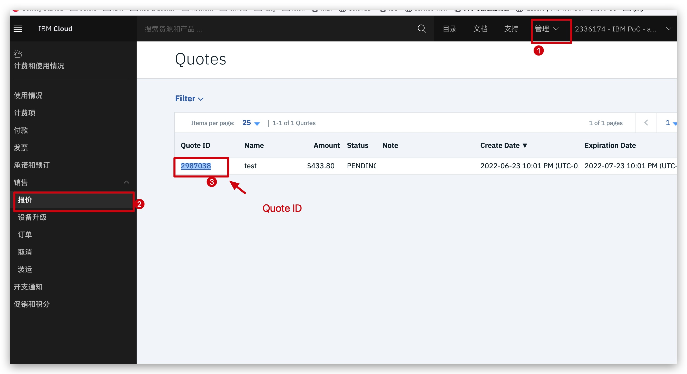
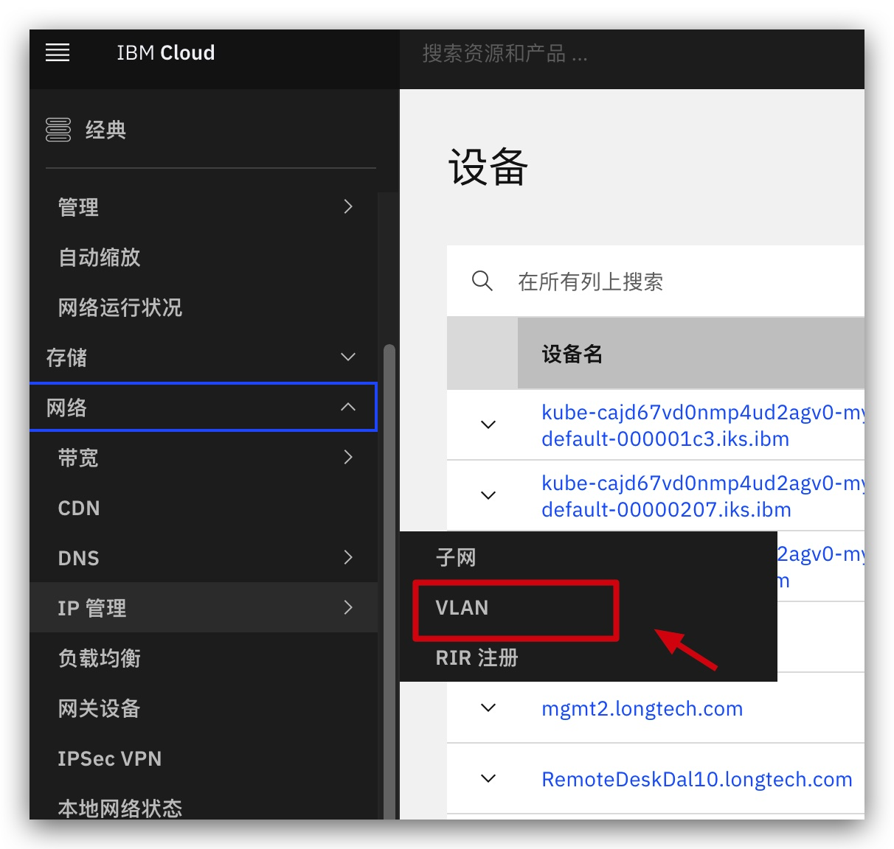
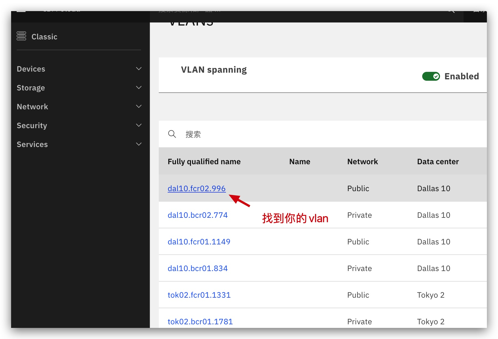
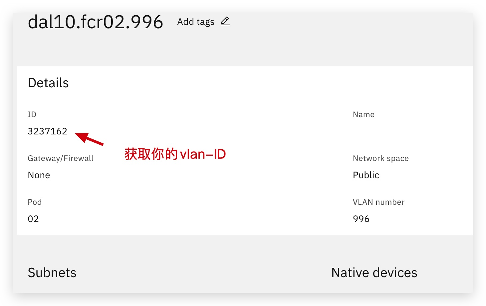

# order_by_quote

使用quote 批量下单，自动生成有规则的设备名称，避免手动输入带来的繁琐。

## 安装依赖性包
pip3 install SoftLayer

## 准备环境
    ```
      # 设置SL API key 到环境变量
      touch SL_ENV.sh
      echo "export SL_USERNAME=apikey" >  SL_ENV.sh
      echo "export SL_API_KEY=<YOUR_API_KEY>" >> SL_ENV.sh
      source SL_ENV.SH
    ```

## 使用举例
    创建2台设备名称为 `s192-dal9.test.com`, `s193-dal9.test.com` 的设备。

    ```
     ./order_by_quote.py --quote_id=2987038 --quantity=2 --ext_test=true --provisionScripts="https://10.1.1.1/init.sh" --prefix="s" --index=192 --suffix="-dal9" --domain="test.com" --private_vlan=3250707
    ```
    上面这个命令将创建 2台(`--quantity=2`)物理机，  
    两台物理机的名字分别为 `s192-dal9.test.com` 和 `s192-dal9.test.com`，  
    这些物理机的名字是由参数  `--prefix` , `--index`，`--suffix` 和 ` --domain` 四部分组合而成，  
    这些物理机使用quote 为2987038, 由 `quote_id`指定， 并且他们将在vlan 3250707 内被创建。  

## 参数说明
 - `quote_id`             IBM 客户经理为您设置的优惠 quote ID
 - `quantity`             下单的设备数量
 - `provisionScripts`     设备初始化脚本
 - `prefix`               设备名称前缀 
 - `index`                设备名称的索引号码，向下顺延
 - `suffix`               后缀名称，可省略
 - `domain`               设备的域名
 - `private_vlan`         私有VLAN 号吗 
 - `public_vlan`          公有VLAN 号吗， 可省略
 - `private_subnet`       私有子网 ID，可省略，需同时指定 `private_vlan`，且必须是该 VLAN 上的 Primary 子网
 - `public_subnet`        公有子网 ID，可省略，需同时指定 `public_vlan`，且必须是该 VLAN 上的 Primary 子网
 - `ext_test`             是否开启扩展测试，扩展测试可以在交付机器之前对机器进行深度测试，从而减小故障率
 - `list_subnets`         传入 VLAN ID，列出该 VLAN 上的所有子网（ID、网段、类型）后退出，不下单
 - `verify`               设为 `true` 时只调用 verifyOrder 校验订单（VLAN/子网是否匹配、quote 是否有效等），不会实际下单。建议正式下单前先用 `--verify=true` 跑一次

## 如何获取您的 quote ID
  - 管理（右上）——> 计费和使用情况 ——> 销售  ——> 报价 ——>  Quota ID
  
## 如何获取您的 vlan ID 

  - 经典架构 ——> 网络 ——> ip管理 ——> VLAN  
    
  - 找到你的内网VLAN 点进去，注意网络类型为 Private
     
  - 获取你的vlan id·
    

## 如何获取您的子网 ID
  - 先按上面的方法拿到 VLAN ID，然后执行：
    ```
    ./order_by_quote.py --list_subnets=3250707
    ```
  - 输出示例：
    ```
    VLAN ID: 3250707, VLAN 号: 951, 类型: PRIVATE, 路由: bcr01a.dal13
    子网 ID, 网段, 类型, 可用 IP 数
    1234567, 10.12.34.0/26, PRIMARY, 61
    1234568, 10.12.35.0/26, ADDITIONAL_PRIMARY, 61
    1234569, 10.200.1.0/28, SECONDARY_ON_VLAN, 13
    ```
  - 下单时只能选 `PRIMARY` 或 `ADDITIONAL_PRIMARY` 类型的子网，Portable / Secondary 子网不能作为服务器主 IP 子网
